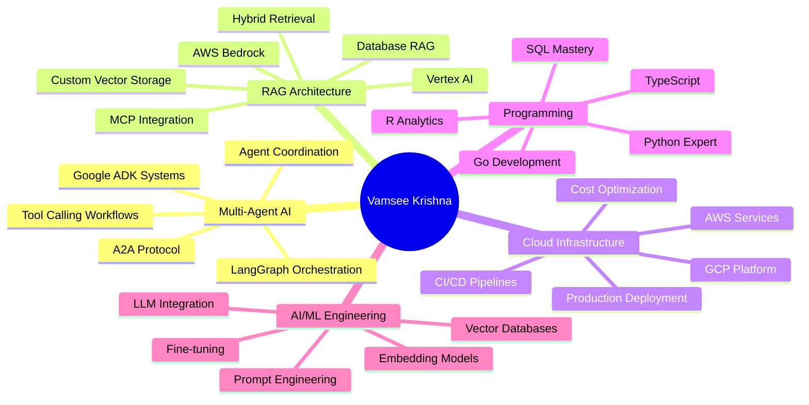
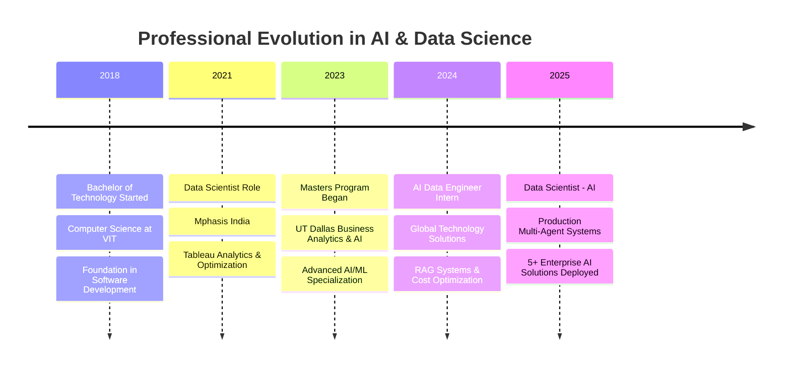

<!-- 
██╗   ██╗ █████╗ ███╗   ███╗███████╗███████╗███████╗    ██╗  ██╗██████╗ ██╗███████╗██╗  ██╗███╗   ██╗ █████╗ 
██║   ██║██╔══██╗████╗ ████║██╔════╝██╔════╝██╔════╝    ██║ ██╔╝██╔══██╗██║██╔════╝██║  ██║████╗  ██║██╔══██╗
██║   ██║███████║██╔████╔██║███████╗█████╗  █████╗      █████╔╝ ██████╔╝██║███████╗███████║██╔██╗ ██║███████║
╚██╗ ██╔╝██╔══██║██║╚██╔╝██║╚════██║██╔══╝  ██╔══╝      ██╔═██╗ ██╔══██╗██║╚════██║██╔══██║██║╚██╗██║██╔══██║
 ╚████╔╝ ██║  ██║██║ ╚═╝ ██║███████║███████╗███████╗    ██║  ██╗██║  ██║██║███████║██║  ██║██║ ╚████║██║  ██║
  ╚═══╝  ╚═╝  ╚═╝╚═╝     ╚═╝╚══════╝╚══════╝╚══════╝    ╚═╝  ╚═╝╚═╝  ╚═╝╚═╝╚══════╝╚═╝  ╚═╝╚═╝  ╚═══╝╚═╝  ╚═╝
-->

<div align="center">

</div>

<div align="center">

</div>

<div align="center">

</div>

<br/>

```bash
┌─[vamsee@ai-terminal]─[~/professional_identity]
└──╼ $ whoami
Vamsee Krishna Kotha • AI Engineer • Multi-Agent Systems Architect

┌─[vamsee@ai-terminal]─[~/career_stats]
└──╼ $ ls -la achievements/
drwxr-xr-x  3 years of enterprise AI experience
drwxr-xr-x  10+ production AI systems delivered
-rw-r--r--  85% reduction in manual processes
-rw-r--r--  90% cost optimization in vector storage
-rw-r--r--  5+ agentic AI solutions deployed
-rw-r--r--  30% improvement in RAG accuracy

┌─[vamsee@ai-terminal]─[~/expertise]
└──╼ $ cat specializations.txt
▸ Multi-Agent Orchestration (LangGraph, Google ADK, A2A Protocol)
▸ Production RAG Systems (AWS Bedrock, Vertex AI, Custom Vector Stores)
▸ Agentic AI Workflows (Tool-Calling, MCP Integration, Database RAG)
▸ Cloud AI Infrastructure (AWS, GCP, Cost-Optimized Architectures)
▸ Enterprise AI Solutions (SaaS Platforms, Document Processing, Analytics)
```

<br/>

<table align="center">
<tr>
<td></td>
<td></td>
<td></td>
</tr>
</table>

<div align="center">

[](https://linkedin.com/in/vamsee-krishna-kotha)
[](https://github.com/vamsee9201)
[](mailto:vamseekrishnakotha2@gmail.com)
[](https://vamsee9201.github.io)

</div>

---

## 🎯 Professional Identity

I'm a **Data Scientist - AI** specializing in production-grade multi-agent systems and enterprise RAG architectures. Currently at **Global Technology Solutions**, I architect and deploy agentic AI solutions that transform complex business workflows into intelligent, autonomous systems. My work spans from building ADK-powered document processing agents that reduce manual effort by 85%, to engineering cost-optimized vector storage solutions that cut expenses by 90% while maintaining production reliability.

With a Master's in **Business Analytics and Artificial Intelligence** from The University of Texas at Dallas and hands-on experience deploying 10+ production AI systems, I bridge the gap between cutting-edge AI research and real-world enterprise applications. My expertise lies in orchestrating multiple specialized agents through LangGraph and Google ADK, implementing the Agent-to-Agent (A2A) protocol for coordinated workflows, and building RAG systems that achieve 30% accuracy improvements through innovative database-aware retrieval strategies.

I'm passionate about making AI systems that don't just demonstrate capability in demos, but deliver measurable business impact in production environments. Whether it's reducing reporting effort by 70% through agentic data analysis or enabling seamless access to 10+ enterprise systems via MCP integration, I focus on solutions that scale, perform, and create tangible value.

---



---

## 🚀 Career Journey & Impact



---

<table width="100%">
<tr>
<td width="50%" valign="top">

### 🤖 **Data Scientist – AI**
**`Global Technology Solutions • United States • Jan 2025 – Present`**


- **Architected and deployed 5+ production multi-agent systems** using LangGraph and Google ADK, serving enterprise customers with complex agentic AI workflows that coordinate multiple specialized agents per workflow
- **Engineered an ADK-powered rules agent** that revolutionized form creation by extracting requirements from uploaded documents and auto-generating portal forms, **reducing manual form creation time by 85%** and eliminating human error in requirements translation
- **Implemented the Agent-to-Agent (A2A) protocol** for orchestrated multi-agent collaboration, enabling seamless coordination between 3+ specialized agents per workflow with context sharing and task delegation
- **Built an agentic data analysis system** integrating BigQuery and enterprise data sources, **reducing manual reporting effort by 70%** through automated insight generation, trend detection, and executive summary creation
- **Integrated MCP (Model Context Protocol) servers** to connect AI agents with external tools and data sources, enabling seamless access to **10+ enterprise systems and APIs** including databases, CRMs, and analytics platforms

**Technologies:** LangGraph • Google ADK • BigQuery • MCP • Multi-Agent Orchestration • A2A Protocol • Enterprise Integration

</td>
<td width="50%" valign="top">

### 🔬 **AI Data Engineer Intern**
**`Global Technology Solutions • United States • Jan 2024 – Dec 2024`**


- **Built production RAG-powered chatbots** using AWS Bedrock and Google Vertex AI with LangChain, serving **3+ enterprise clients** with agentic retrieval workflows featuring tool-calling, context management, and multi-turn conversations
- **Engineered a custom vector storage solution on S3** replacing AWS OpenSearch Serverless, achieving **90% cost reduction** in vector database expenses while maintaining production reliability and sub-second query performance
- **Developed a database RAG system** enabling LLMs to agentically query SQL databases with natural language, **improving response accuracy by 30%** over traditional vector-only retrieval on structured data through schema-aware query generation
- **Architected a RAG SaaS platform** enabling customers to upload documents and deploy AI chat widgets on their websites, successfully **onboarding 5+ early adopters** with custom branding and domain-specific knowledge bases
- **Optimized retrieval pipelines** through hybrid search strategies combining dense embeddings, BM25, and metadata filtering, achieving superior relevance scores across diverse document types

**Technologies:** AWS Bedrock • Google Vertex AI • LangChain • S3 Vector Storage • SQL RAG • SaaS Architecture • Hybrid Search

</td>
</tr>
<tr>
<td width="50%" valign="top">

### 📊 **Data Scientist**
**`Mphasis • India • Jan 2021 – Dec 2022`**


- **Developed machine learning models** for classification, regression, and predictive analytics using Python, Pandas, NumPy, Scikit-learn, and XGBoost, improving model-driven decision support by approximately 18%.
- **Performed data preprocessing,** exploratory analysis, feature engineering, and statistical analysis using Python, SQL, and Pandas, reducing data preparation effort by approximately 25% across recurring analytical workflows.
- **Built automated ETL and data-preparation pipelines** using Python and SQL, integrating structured and semi-structured data sources and reducing manual data-processing time by approximately 30%.
- **Developed time-series forecasting models** using ARIMA, Prophet, and Scikit-learn to analyze demand patterns and forecast
business metrics, improving forecast reliability by approximately 15%.
- **Designed interactive Power BI dashboards**  using SQL, DAX, and Power Query, consolidating business KPIs and reducing recurring reporting turnaround time by approximately 25%.


**Technologies:** Python • SQL • Pandas • NumPy • Statistics • Scikit-learn • XGBoost • ARIMA • Prophet • Power BI • DAX • Power Query

</td>
<td width="50%" valign="top">

### 🎓 **Academic Foundation**
**`Vellore Institute of Technology • India • 2018 – 2022`**


- **Bachelor of Technology in Computer Science** with focus on software engineering fundamentals, data structures, algorithms, and system design
- Built strong foundation in **programming paradigms, database systems, and software architecture** that underpins current AI engineering work
- Developed multiple **full-stack projects** demonstrating end-to-end software development capabilities from requirements gathering to deployment
- Gained expertise in **problem-solving methodologies** and computational thinking that translates directly to AI system design and optimization

**Core Competencies:** Algorithms • Data Structures • System Design • Software Engineering • Database Management

</td>
</tr>
</table>

---

## 💼 Signature Projects & Impact

<table width="100%">
<tr>
<td width="50%" valign="top">

### 🔗 **Data Science ADK Agent**
**Conversational Analytics Platform**

A local-first web application enabling CSV dataset exploration through natural language conversation, featuring Google ADK coordinator with embedded analyst agent for focused questions and exploratory analysis.

```yaml
Technology Stack:
Backend: Python • FastAPI • Google ADK
AI/ML: Gemini 3.8 Flash • LangChain • Agentic Tools
Data: Pandas • Scikit-learn • Statistical Analysis
Frontend: Framework-free Responsive UI
Infrastructure: Local-first • Session Management
```

**Key Achievements:**
- **Strict data governance** with UTF-8 CSV uploads up to 25 MB and four offline scikit-learn sample datasets
- **Comprehensive analysis toolkit** including profiling, missingness detection, duplicates, outliers, correlations, grouping, and filtering
- **Statistical rigor** with hypothesis testing and server-rendered charts for visual insights
- **Immutable data architecture** with preview-and-confirm cleaning operations maintaining original dataset integrity
- **Guarded ML baselines** for classification and regression with model comparisons and diagnostic visualizations
- **Isolated session management** with streamed analysis progress and 60-minute TTL for security

**Impact:** Democratizes data science workflows for non-technical users, reducing time-to-insight by enabling natural language queries over complex datasets

</td>
<td width="50%" val
